

  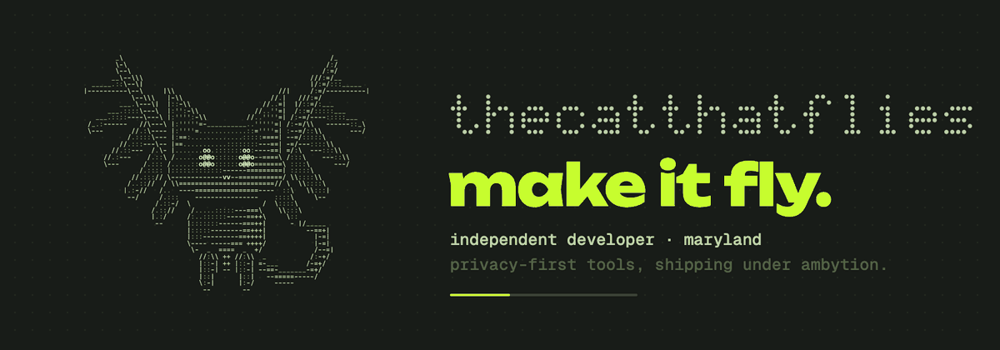

  hey, i'm <b>aiyan</b>. independent developer in maryland building privacy-first tools, from apps to self-hosted servers, data science competitions to bug and security bounties. shipping under <a href="https://ambytion.net">ambytion</a>.

  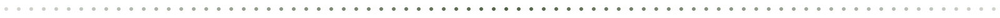

  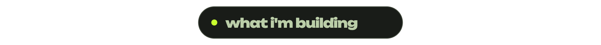

  <a href="https://getpanels.app">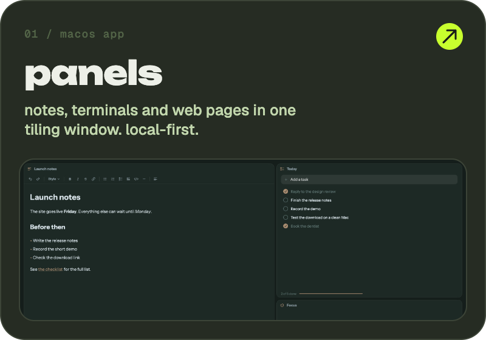</a>
  <a href="https://minijs.ambytion.net">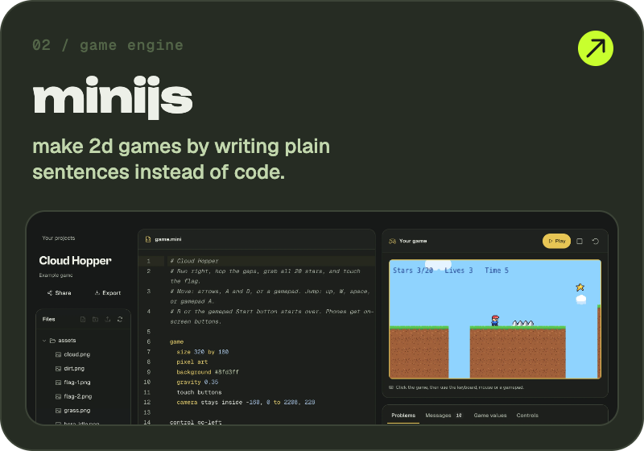</a>
  <a href="https://unboxx.aiyan.tech">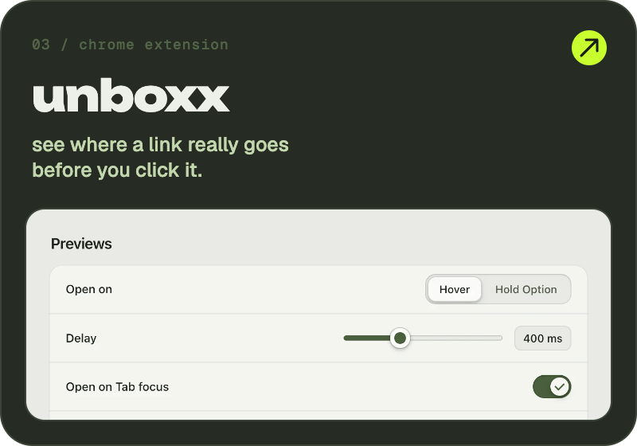</a>

  <a href="https://github.com/ambytionhq/cleanly">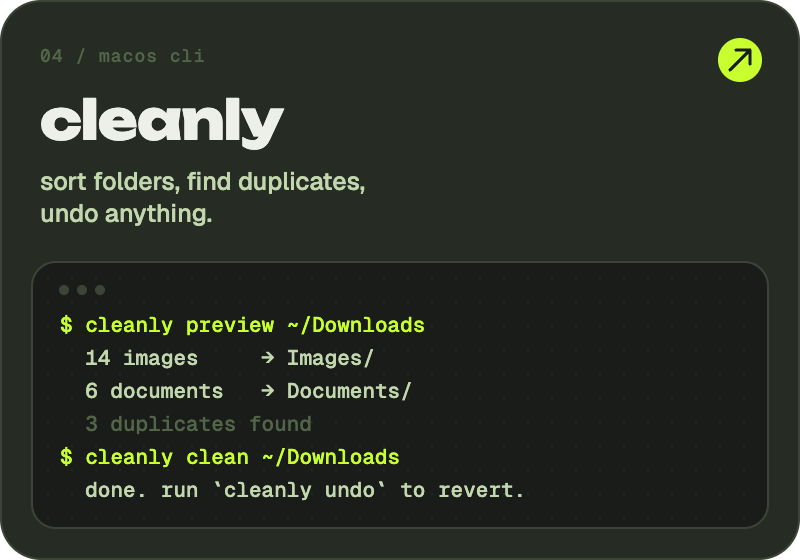</a>
  <a href="https://ambytion.net">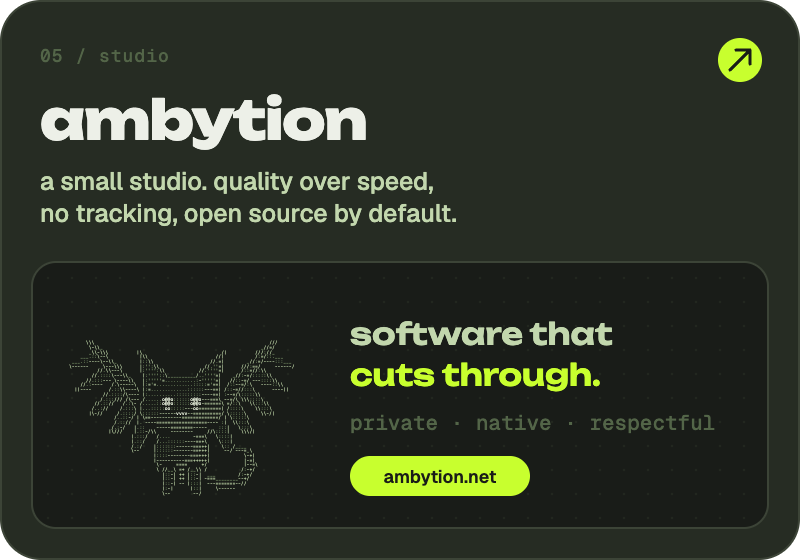</a>
  <a href="https://www.kaggle.com/competitions/name-that-llm/">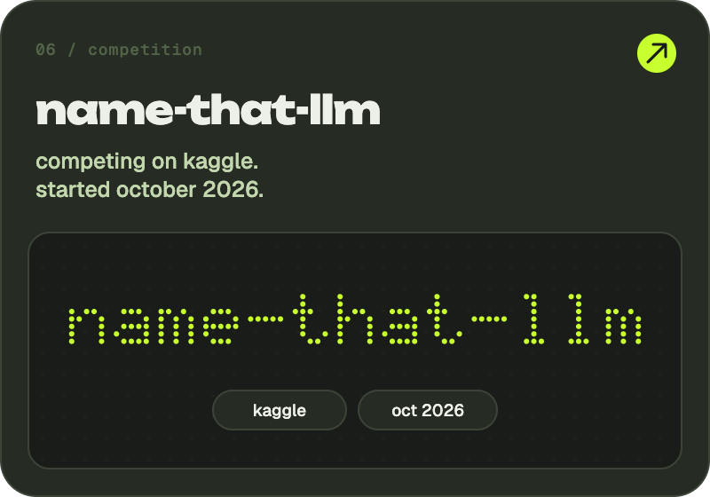</a>

  

  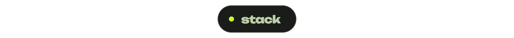

  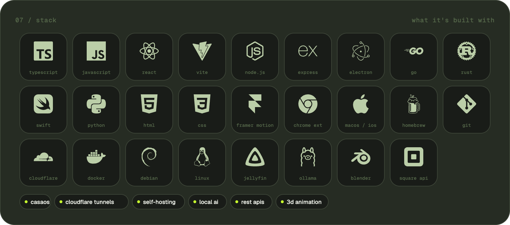

  

  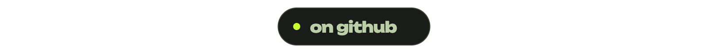

  
  
  
  

  

  

  <a href="https://discord.com/users/1149437523785957508">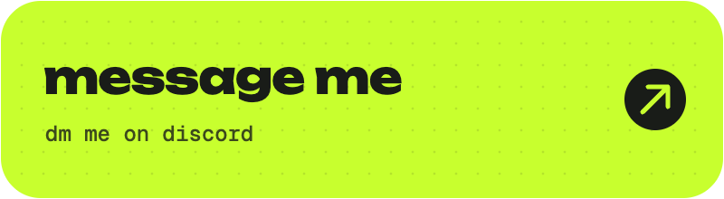</a>
  <a href="mailto:hello@aiyan.tech">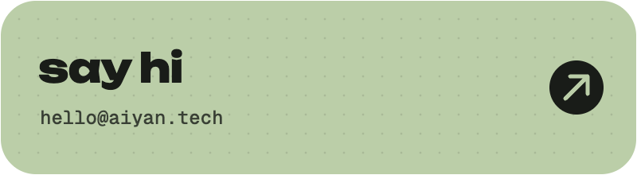</a>

  <a href="https://aiyan.tech">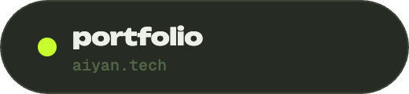</a>
  <a href="https://ambytion.net">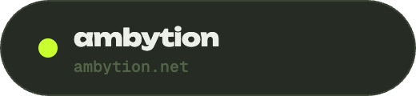</a>
  <a href="https://www.kaggle.com/competitions/name-that-llm/">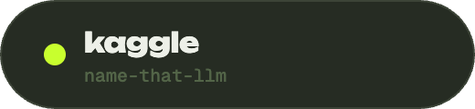</a>

  legal: <a href="mailto:legal@aiyan.tech">legal@aiyan.tech</a>

